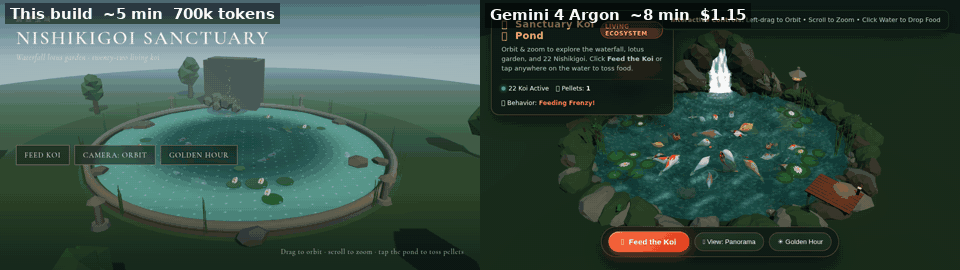

# Nishikigoi Sanctuary

A living koi pond: orbit and zoom around a waterfall and lotus garden while 22 koi cruise the water. Feed them or tap the pond to toss pellets, switch camera views, and flip to golden hour.

## Comparison

Left is this build. Right is [Gemini 4 Argon high](https://gemini-4-argon.vercel.app/tests/gemini-4-argon-high-koi-pond/index.html).



| | This build | Gemini 4 Argon high |
|---|---|---|
| Time | ~5 min | ~8 min |
| Cost / usage | 700,000 tokens | $1.15 (Devin 75% Argon promo) |
| Prompt | Same living Nishikigoi sanctuary | Same living Nishikigoi sanctuary |

## Run

```bash
npm install
npm run dev
```

Open `http://localhost:5173`.

## Controls

- Drag to orbit, scroll to zoom
- Tap the pond or **Feed Koi** to toss pellets
- **Camera** cycles Orbit, Waterfall, Lotus, Follow
- **Golden Hour** switches daylight and dusk
